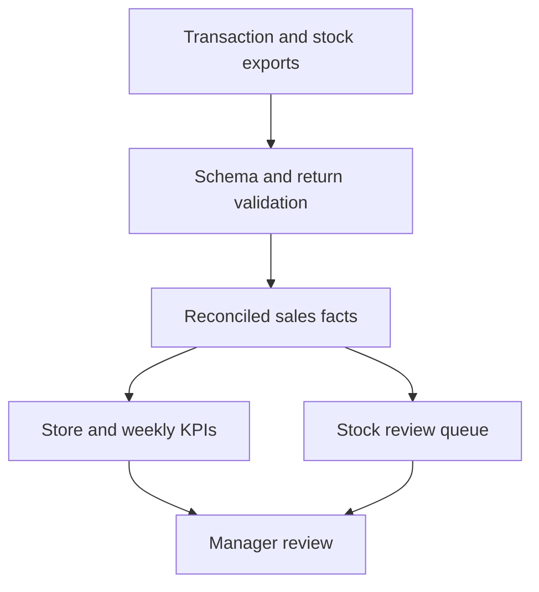

# Business brief and requirements

## Scenario and outcome

Northbank Retail is fictional. Its operations lead needs a consistent weekly view of sales, refunds and replenishment across three stores. The proposed outcome is a review queue with traceable calculations. A real implementation would require stakeholder interviews and baseline measurement; the roles and requirements below are scenario assumptions, not evidence of interviews conducted.

| Stakeholder role | Decision or concern | Proposed validation |
|---|---|---|
| Operations lead | Compare stores on the same definitions | Reconcile weekly and store totals |
| Store manager | Explain returns and stock coverage | Inspect original-sale references and stock snapshot |
| Buyer | Avoid ordering stock already on order | Review inventory position and supplier packs |
| Finance | Revenue and COGS accuracy | Independently reproduce signed money totals |

## As-is and to-be

As-is assumption: separate transaction exports and a stock snapshot are manually reviewed, so definitions can diverge.

## Scope and prioritised requirements

| ID | Priority | Requirement | Acceptance criterion |
|---|---|---|---|
| R1 | Must | Reconcile net revenue and gross profit | Independently computed integer-pence totals match SQL outputs |
| R2 | Must | Validate refunds against their original sales | Unknown, mismatched, early or excessive returns reject the entire import |
| R3 | Must | Calculate stock using on-hand plus on-order | An item above its reorder point receives no order suggestion |
| R4 | Must | Respect supplier pack sizes | Suggested order quantity is a non-negative whole pack multiple |
| R5 | Must | Support clear manager review | Store filter and stock review table expose definitions and period |
| R6 | Should | Provide portable evidence | CSV/JSON outputs and dashboard regenerate with Python alone |
| R7 | Could | Add seasonality and supplier constraints | Defer until stakeholder-validated demand and procurement data exist |

## User stories

As an operations lead, I want refunds included consistently so store comparisons use the same basis.

Given a sale and a valid refund, when the report runs, then revenue is reversed for the refunded quantity and cost is reversed only if the item is resalable.

As a buyer, I want incoming stock included so I do not order stock twice.

Given inventory position at or below the reorder point, when demand and lead time are calculated, then the recommended quantity reaches the review-period target in whole supplier packs.

## Risks and decision log

- Demand estimates use calendar days, including days with zero sales; using only trading days would change the policy.
- Sales do not measure unconstrained demand during stockouts. Check lost-sales data before live use.
- Stock snapshot date must match the transaction period end; reject a mismatched snapshot.
- No replenishment order is placed by this prototype.
- Success measures for a real pilot: reconciliation error rate, time to review exceptions, stockout frequency and excess stock value. Establish actual baselines before claiming improvement.
